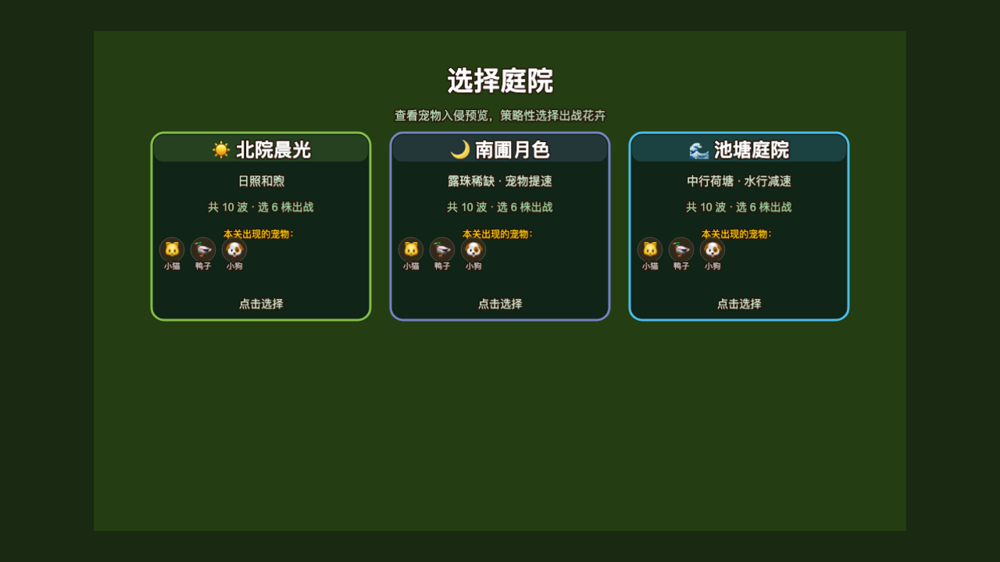

# 花园保卫战

竖屏网格种花塔防：用**种子**种花、用**花粉**进化，资源自动入账；挡住宠物，守住花房 3 颗心。



## 玩法

1. **选难度开战**（休闲 / 标准 / 专家）
2. **底栏选花卡，点草坪格子种植**（消耗种子）
3. 宠物自上而下入侵；撞到花会啃咬，冲到栅栏扣 1 颗心
4. **资源自动入账**：花园每 5s 基础产种；每株花也会小额结种；荷花高产种子+花粉；击杀掉落双资源
5. **点已种的花用花粉进化**（最高 Lv3），或用铲子回收 40% 种子
6. 无尽波次，每 5 波大型波；心心耗尽结算

## 花语（进化 Lv1→5）

| 花 | 种子 | 定位 | 高阶弹道 |
|---|---|---|---|
| 月季 | 50 | 单体输出 | 追踪弹 |
| 水仙 | 75 | 减速 | 旋风波 |
| 海棠 | 100 | 多发 | 激光 |
| 荷花 | 125 | 产种授粉 | 抛物落英溅射 |
| 兰花 | 150 | 光环增伤 | 激光穿刺 |

进化会切换**名贵贴图**（super → epic → legendary）并改变弹道形态。

## 运行

```bash
npm run dev      # 面板入口 http://localhost:4000/g/garden-defense/
npm run test     # vitest
npm run build    # tsc + vite
npm run lint     # tsc --noEmit
```

## 技术要点

- 数值唯一源 `src/config.ts`（网格、种子/花粉、波次、难度）
- 经济：`addSeeds` / `addPollen` 自动入账；无天降可拾取物
- 实体：`Flower` / `Pet` / `Bullet`；荷花 `produceSeeds` + `producePollen`
- 重开 `shutdown` 清理 timer/粒子
- 进度存 `localStorage`（最佳波次 / 击杀 / 静音）
- 设计说明见 `docs/DESIGN.md`
