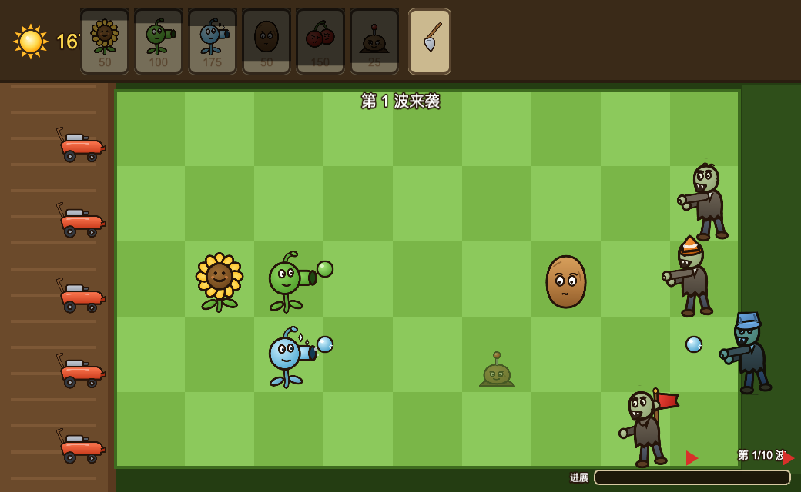

# 植物大战僵尸·杂交版

Phaser 3 塔防：5×9 草坪种植植物，在传送带上随机刷卡、融合出变异怪兽，抵挡 10 波（含僵尸猎犬）进攻。



## 玩法

- **传送带选卡**：顶部随机轮班刷出植物，点卡即得（免阳光），种植后从带扣一张；容量 8、间隔约 4.2s，开局先铺 4 张
- **12 种植物**：向日葵 / 豌豆射手 / 寒冰射手（减速）/ 双发射手 / 坚果墙（3 段破损）/ 高坚果 / 樱桃炸弹（3×3）/ 土豆地雷（埋伏秒杀）/ 火爆辣椒（整行清屏）/ 三线射手 / 大嘴花（近战吞噬）/ 冰西瓜（范围溅射）
- **融合变异**：点击已占用格子的植物即可用手中的卡合成新株——
  - **专属怪兽配方**：特定跨物种组合确定性产出命名怪物（极寒冰痕 / 阳光机炮 / 钢铁巨颚 / 暴雨冰瓜 / 三重寒冰 / 极寒三线 / 阳光冰瓜 / 寒冰连发），自带独特战术技能 + 顶格大招特效
  - 同类进化（豌豆→双发、坚果→高坚果）、异类 10% 混沌随变（可能突变出爆炸类）、属性 roll（凋零/精锐/超强）
  - 超强变异金色光环 + 星尘粒子环绕；每株仅可融合 1 次
- **5 类僵尸**：普通 / 路障（护甲）/ 铁桶（重护甲）/ 旗帜（大波高速）/ 僵尸猎犬（赤红小体型，2.5 倍速突袭，第 6 波起）
- **10 波防守**：第 5、10 波大波预警，进度条带旗标；小推车每行最后救命，耗尽破线即失败
- **爽感**：命中粒子 / 伤害飘字 / 击杀顿帧 + 慢动作 / 连杀音符递增（每 5 连击奖阳光）/ 爆炸白闪冲击波烧痕 / 五彩纸屑雨

## 操作

1. 点顶部传送带卡槽选取植物（免费，金色高亮）；右键或再点取消
2. 点草坪空格种植；点已占用格触发融合
3. 点场上阳光收集；点铲子槽进入铲除模式

## 运行

```bash
npm run dev        # 面板统一入口 http://localhost:4000/g/pvz-hybrid/
npm test           # vitest 单元测试（波次/网格/融合/传送带）
npm run build      # tsc + vite 产物构建
npm run lint       # tsc --noEmit 严格类型检查
```

## 技术要点

- Phaser 3 + TypeScript strict，场景分层：`BootScene` / `GameScene` / `UiScene`，经 `src/bus.ts` 事件总线通信
- 纯逻辑与渲染解耦可单测：`GridModel`（网格）/ `WaveManager`（波次）/ `Conveyor`（传送带，纯逻辑类）/ `Fusion`（融合 roll，纯函数）
- `src/systems/Fx.ts` 集中打击感特效（粒子/飘字/冲击波/混沌风暴/纸屑雨），一律 create-per-burst + 定时自毁
- `window.__pvz` 为 e2e 调试钩子（加阳光/定向出怪/读状态含 `belt` 列表）

## 目录

```
├── public/assets/     # 渲染后的游戏贴图（PNG，由 assets-src 生成）
├── assets-src/svg/    # 手绘 SVG 源（改完跑 npm 脚本重渲染）
├── src/               # 游戏源码（scenes/entities/systems）
├── tests/             # vitest 单测
├── docs/design.md     # 设计文档
└── pvz_hybrid.html    # 旧版单文件杂交版（留档，不再是入口）
```